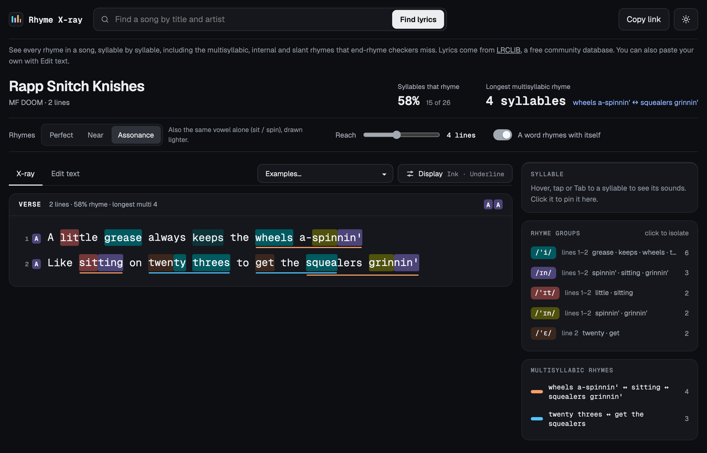

# Rhyme X-ray

Paste a rap verse or any lyric and see its rhymes coloured syllable by syllable, the way
"rap rhymes deconstructed" videos mark them up. It finds what spelling-based end-rhyme
checkers miss: multisyllabic rhymes, internal rhymes in the middle of a line, and slant
rhymes (same vowel, different consonants).



**Try it:** <https://baphaelman.github.io/rhyme-xray/>

The page opens on a bar from MF DOOM's "Rapp Snitch Knishes" ("A little grease always keeps the wheels a-spinnin' /
Like sitting on twenty threes to get the squealers grinnin'"). Its four-syllable rhyme
"wheels a-spinnin'" ↔ "squealers grinnin'" is exactly what spelling-based checkers miss.

## Run it

Open `index.html` in a browser. There is no build step.

The first load downloads the CMU Pronouncing Dictionary (about 4.7 MB) from jsDelivr
(`cmu-pronouncing-dictionary@3.0.0`), so you need a connection. If the download fails,
every word is guessed from its spelling instead and results get rougher.

## Use it

- **Find a song**: type a title and artist, pick a match, and the lyrics load and get
  X-rayed. Lyrics come from [LRCLIB](https://lrclib.net), a free community lyrics database.
  The page fetches them in your browser; nothing is stored in this repo.
- **Edit text** to paste your own verse, then **X-ray it** (or press Ctrl/⌘+Enter).
  Lines such as `[Chorus]` become section headings and are not analysed. A blank line or a
  heading starts a new section: rhymes never link across one, and end-rhyme letters restart.
- Each section gets its own card with its line count, how much of it rhymes, its longest
  multi and its rhyme scheme. With more than one section, a list on the left jumps between
  them, and the rhyme groups and multis on the right follow the section you're reading.
  A section that repeats an earlier one word for word (a second chorus) is folded;
  **Show it** opens it.
- **Copy link** copies an address that reopens the verse with the same settings: an LRCLIB
  song by its id, an example by name, or pasted text compressed into the address. The
  address bar keeps up as you go, so it can be copied from there too.
- Hover or tap a syllable, or Tab into the verse and move with the arrow keys. Its details
  (the word and syllable in IPA, its rhyme part, what it rhymes with and on which line, the
  match type, where the pronunciation came from, and which reading was chosen when a word
  has several) fill the panel at the top of the right-hand column. On a phone or a narrow
  window they open in a card over the syllable instead.
- Click a syllable (or press Enter on it) to pin its details, then select any of the text
  to copy. Esc, the × or a click elsewhere lets go.
- **Display** sets how rhymes are drawn: **Ink** sets syllables on coloured chips, **Text
  tint** colours the letters instead; multisyllabic rhymes show as an underline, a band, an
  outline or not at all; spacing is comfortable or compact. The default is Ink with
  underlines. The page is dark by default and the
  sun/moon button switches theme. Your browser remembers these choices.
- **How Rhyme X-ray works**, below the verse, explains the eight steps one dropdown at a
  time. Each step shows, beside the rule, what it did to the verse on screen: the IPA
  of its words, the syllables and rhyme parts, the pairs at each match type, and the
  longest multi aligned syllable by syllable.
- Click a rhyme group, a multisyllabic rhyme, an end-rhyme letter in the margin or the
  longest-rhyme reading to isolate it and scroll to it. Click again to step to the next
  occurrence. Press Esc to clear.
- **What counts as a rhyme** sets the loosest match allowed: Perfect, Near or Assonance.
- **A word rhymes with itself** decides whether repeating a word counts as a rhyme.
- **Reach** sets how many lines apart two syllables may be and still count as rhyming.
- **Examples → Rhyme types, one per line** gives one line per type. Each line explains its
  type, and the type word rhymes in exactly that type ("Perfect: a tail shared by surf and turf",
  "Near: the coda grew a beard").
  Every other stressed vowel appears only once, so no rhyme crosses lines.

Reading the colours:

| Mark | Meaning |
| --- | --- |
| Coloured chip (Ink) or coloured letters (Text tint) | perfect or near rhyme with another syllable of the same colour |
| Fainter colour | linked by vowel only (assonance) |
| Underline (or band / outline) | a multisyllabic rhyme; every part of one shares its own colour |
| Dotted underline | a word not in the dictionary; its sounds were guessed from the spelling |
| Letter beside the line number | the end-rhyme scheme, coloured like the rhyme it stands for (A, B, …; `x` = the line ending does not rhyme) |

## How it decides

1. **Sounds, not spelling.** Each word is looked up in the CMU dictionary. Before falling
   back to a spelling guess, lyric spellings are normalised. "spinnin'" is read as
   "spinning" with the g dropped. "tha", "'em", "ya", "imma" and "tryna" are mapped.
   Plurals, -ed, -ing, -er, -ers, -y and -ly are built from their base words. Numbers
   become words.
2. **Choosing a reading.** 8,444 dictionary words have more than one pronunciation
   (REcord / reCORD, live, read, again). The dictionary's first entry is sometimes the
   noun and sometimes the verb, so it is not trusted blindly:
   - *Grammar*: stress-shift pairs take the verb stress after "to", "I", "will", "don't"…
     or before an object ("record it"), and the noun/adjective stress after "a", "the",
     "so", "is"… With no cue they take the noun/adjective stress, the more common one.
     A small table does the same for vowel changes (live, lead, wind, close, use).
   - *Rhyme*: if another reading makes a perfect or near rhyme within reach that the
     grammatical one does not, it wins. That is how "read" rhymes with "week" in one
     verse and "bed" in another, and "again" with "pain". An explicit grammar cue needs
     a perfect or end rhyme to be overruled.
   - Function words ("a", "the", "to") always keep their usual reading.
   - The syllable details say which reading was used and why.
3. **Syllables.** Phonemes are split into syllables. A syllable's *rhyme part* is its vowel
   plus every consonant up to the next vowel. A consonant between vowels counts for both
   syllables, which is how "squeal-ers" rhymes with "wheels".
4. **Tiers** (Pattison's taxonomy):
   - *Perfect*: same vowel and the same consonants (grease / peace).
   - *Near*: same vowel, and consonants from the same family (stops, fricatives, nasals,
     voicing ignored), or one extra consonant (wheels / squealers, grease / threes, time / line).
   - *Assonance*: same vowel only (sit / spin).
   - The cot/caught vowels are merged, except before r ("door" does not rhyme with "car"). Unstressed /ə/ and /ɪ/ count as one schwa.
5. **Who is compared on their own.** Stressed syllables of content words, the last
   syllable of every line, and full unstressed endings like the -y of "sweaty".
   Unstressed function words ("the", "a", "in") are only coloured inside a multi. Two
   syllables are compared only within Reach lines and inside one section.
6. **Multisyllabic rhymes.** Two runs of syllables match in order, starting on a stressed
   syllable on both sides. Stressed positions must match at the chosen tier. Unstressed
   schwas may stand in for each other. One syllable without primary stress may break the
   pattern in the middle (shadow boxing / battle rocking). A run needs at least two
   positions that carry the rhyme. A run that only repeats the same words is ignored.
   Overlapping runs of one pattern on a line are drawn as one. Each multisyllabic rhyme
   gets a colour of its own, separate from the syllable colours.
7. **Groups and colours.** Links (single or inside a multi) join syllables into groups,
   closest tier first. A link never merges two groups that are each held together by a
   closer tier: near rhymes don't fuse two sets of perfect rhymes (peace / lease and
   keep / deep stay apart), and assonance doesn't fuse near ones. A looser link can still
   bring a lone syllable into a group. A group is named by the rhyme part most of its
   members share, or by its vowel when none has a majority, with a stress mark when most
   of its syllables are stressed (/ˈɪn/ for spin / grin, /ɪn/ for the unstressed -nin' /
   -nin'). Groups that sit within reach of each other get different colours from a
   14-colour palette.
8. **Readings.** Share of syllables that rhyme, and the longest multisyllabic rhyme.

## Where the sources agree, and where they don't

I compared published ways of finding and colour-coding rap rhymes before setting the
rules. The tests in `test/engine.test.mjs` encode the points they agree on.

**They agree that:**

- **The stressed vowel carries the rhyme.** Malmi et al.'s Raplyzer / DopeLearning rhyme measure
  uses *only* vowels. Wadsworth & Needle and the Vox / Martin Connor breakdowns treat
  assonance as rhyme. Hirjee & Brown and the WSJ *Hamilton* algorithm score vowels first.
- **Multisyllabic rhymes are matching vowel sequences across word boundaries** (Malmi's
  "longest matching vowel sequence"; Hirjee & Brown's phoneme alignment). They are shown
  as one unit: same colour per rhyme in Wadsworth & Needle, arcs in RapViz.
- **Stress matters** for deciding which syllables anchor a rhyme (WSJ, Hirjee & Brown).
  Unstressed syllables in the middle of a multi need not rhyme.

**They differ on:**

- **Consonants.** Raplyzer ignores them. Hirjee & Brown and the WSJ score the consonants
  after the vowel by similarity. Wadsworth & Needle's main rhyme class requires the
  final consonant. → exposed as the Perfect / Near / Assonance setting.
- **Identical words.** Wadsworth & Needle list "identical rhyme" as a rhyme type.
  Raplyzer's code returns 0 when the two words are the same (`lyrics.py`,
  `rhyme_length_fixed`). → exposed as the "A word rhymes with itself" switch (on by
  default, since repetition is often deliberate).
- **Distance.** Raplyzer looks back 10 words. Wadsworth & Needle allow rhymes more than a
  bar apart. → exposed as Reach (default 4 lines).

### Sources

- E. Malmi, P. Takala, H. Toivonen, T. Raiko, A. Gionis, "DopeLearning: A Computational
  Approach to Rap Lyrics Generation", KDD 2016, <https://arxiv.org/abs/1505.04771>, and the
  Raplyzer source, <https://github.com/ekQ/raplysaattori>.
- H. Hirjee, D. G. Brown, "Using Automated Rhyme Detection to Characterize Rhyming Style in
  Rap Music", *Empirical Musicology Review* 5(4), 2010. Also "Automatic Detection of
  Internal and Imperfect Rhymes in Rap Lyrics", ISMIR 2009.
- D. G. Brown, R. Hutchinson, C. E. Lamb, "A systematic mapping review of algorithms for
  the detection of rhymes". It summarises the WSJ *Hamilton* work by Hinton & Eastwood.
- B. K. Wadsworth, S. Needle, "Rhyme, Metrical Tension, and Formal Ambiguity in Kendrick
  Lamar's Flow", *Intégral*, <https://theory.esm.rochester.edu/integral/?p=6643>.
- P. Pattison, *Writing Better Lyrics* (perfect, family, additive / subtractive and
  assonance rhymes).
- Vox Earworm with Martin Connor, syllable-by-syllable breakdowns of rap rhyme schemes.

## Known limits

- Readings come only from the dictionary. Rappers bend vowels further ("orange" /
  "door hinge") than any listed pronunciation, and those bends are missed.
- The grammar cues look one word either side. Longer-range grammar ("the records I
  never *record*") can still pick the wrong stress.
- The letter-to-syllable mapping is a heuristic. Words with silent letters or syllabic
  consonants can split oddly ("diddly" → did·dl·y).
- With Assonance on, a dense verse can colour 70% or more of its syllables. That matches
  vowel-based breakdowns, but stray links between common vowels do appear. Switch to Near
  for a stricter view.
- Spelling guesses are crude: they only cover what the normalisation rules miss.
- Inside a section, perfect rhymes still chain from window to window: a verse that keeps
  returning to one rhyme keeps one colour. The group list shows each group's line range.
- Song search depends on LRCLIB's coverage and transcriptions.

## Develop

```sh
npm install   # fetches the dictionary for the tests
npm test
```

- `engine.js`: all analysis. Pure functions, no DOM. Loaded as a classic script by the
  page and with `require()` by the tests.
- `index.html`: the interface (inline CSS and UI script).
- `test/engine.test.mjs`: unit tests, consensus tests and the identical-rhyme switch.
